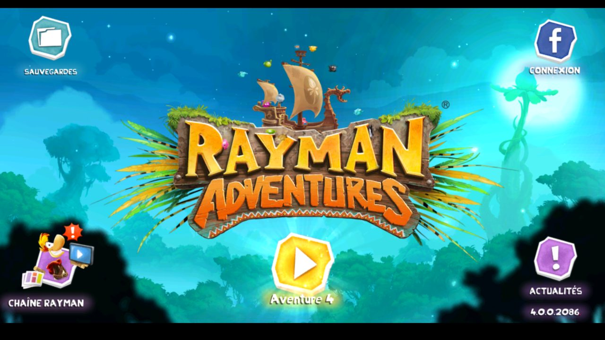
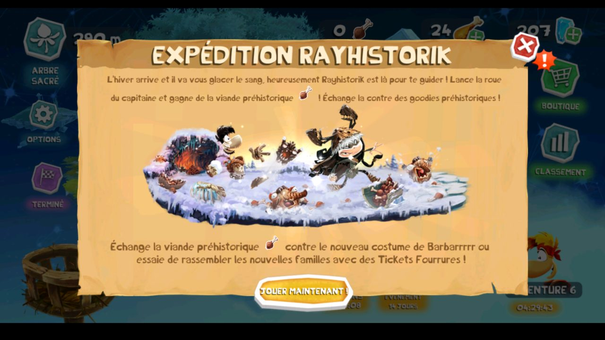
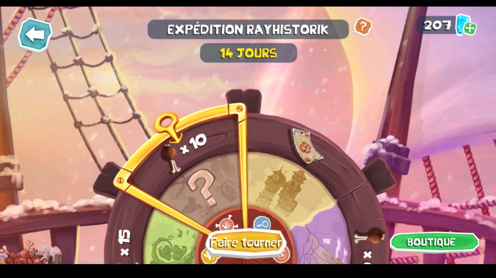

# Rayman Adventures Offline

**Play Rayman Adventures again on Android: no internet, no account, nothing to set up.**

Ubisoft shut down the servers of *Rayman Adventures* on June 26, 2023. Since then the game is stuck: you can't start new adventures and eggs never hatch. This project brings the game back to life. A small replacement server lives inside the app itself, so everything runs on your phone.

## Download and install

1. Go to the [**Releases**](../../releases/latest) page and download **`RaymanAdventures_Offline.apk`** (about 445 MB, everything is included).
2. If the original Ubisoft version is still installed, **uninstall it first**.
3. Open the downloaded file to install it. Your phone may ask you to allow installing apps from this source.
4. Launch the game. The very first launch shows a black screen for a few seconds while the game unpacks its data; that's normal.

**Already have an older version of this project?** Install the new APK over it: your progress is kept.

**What you need:** an Android phone or tablet (64-bit ARM, like almost every device from the last few years) with about 1 GB of free space.

## What you can do

- Play all the **adventures** and explore the worlds, unlocked as the Sacred Tree grows.
- **Hatch eggs** in the incubator, use **elixirs**, and collect the 380 Incrediballs.
- Scratch **lucky tickets and golden tickets** (with the original odds).
- Get the **daily gift**, run the **daily challenge**, find **Charlie's hidden eggs**, use the **magnifying glass**.
- **Seasonal events** are back: spin wheels, treasure hunts and marathons, with their currency and shop. 14 events a year, each with its own costume and Incrediball families (the game only kept the scenery of the last event of each kind, so events of the same kind look alike). They start appearing after your **6th adventure**.
- **Mini events** (Mini Marathon, Skull Scramble) every weekend.
- **News** ("Actualités" on the title screen): the event running now and the next ones, this weekend's mini event and the daily challenge.
- **All costumes**: the ones that only came in real-money packs (Assassin, Splinter, Vaas, Christmas, WeForest, Persia...) and the Facebook-only **Ray-box** are sold for gems in the costume shop.
- **Packs for gems**: the packs that cost real money are sold for gems instead: event currency, challenge tokens, and the special packs of the shop ("Le Must-have pack" and the next ones: costumes, elixirs, tickets...). A pack costs about 20% less than its contents bought one by one.
- **3 save slots** (the "Sauvegardes" button on the title screen), with **save codes**: the orange button of a slot gives a code, and the purple button of an empty slot copies that game into it (handy to keep a backup or start a second copy). Codes work on the same phone only and stay valid 7 days.
- **Achievements** with their rewards.
- **Leaderboards with other players**: the "Classement" tree and the daily challenge ranking are filled with fictional players (names, countries, costumes, Incrediballs you can visit). The challenge ranking is for fun: every rank gets the reward.
- **No ads**: the "Regarder une publicité" buttons (free wheel spin, daily gift bonus, revive, mission change, adventure time extension...) give their reward right away, without any video. Forced ads are removed too.
- Play with a **controller** (Xbox and others): connect it **before** launching the game.

## What no longer works

These needed services that are gone for good:

- Buying gems with **real money**. You earn gems by playing. (The time-saving subscriptions, perk packs and new-creature egg packs are gone too.)
- **Facebook**: login, friends, gifts between friends.
- **Real players** in the leaderboards (the ones you see are fictional), and Facebook friends.
- **Cloud save**, and save codes **between two phones** (a code only works on the phone that made it).
- The **Google Play Games** login was removed, as it could never work again.

## Good to know

- **"Pas assez de gemmes !"**: you don't have enough gems for what you're buying. Play to earn more.
- **New game:** tap "Sauvegardes" on the title screen and pick an empty slot. Your other games are kept.
- **Gems** are shared between the save slots.

## Questions and problems

Open an [issue](../../issues) and describe what happened: what you did, what you saw, and your device model.

## About

This is a fan-made preservation project, not affiliated with or endorsed by Ubisoft. *Rayman* and *Rayman Adventures* are trademarks of Ubisoft Entertainment. The game was free to play; this project only aims at keeping it playable now that its servers are gone.

Developers and curious minds: how it works and how to build it is explained in [docs/DEVELOPERS.md](docs/DEVELOPERS.md).
