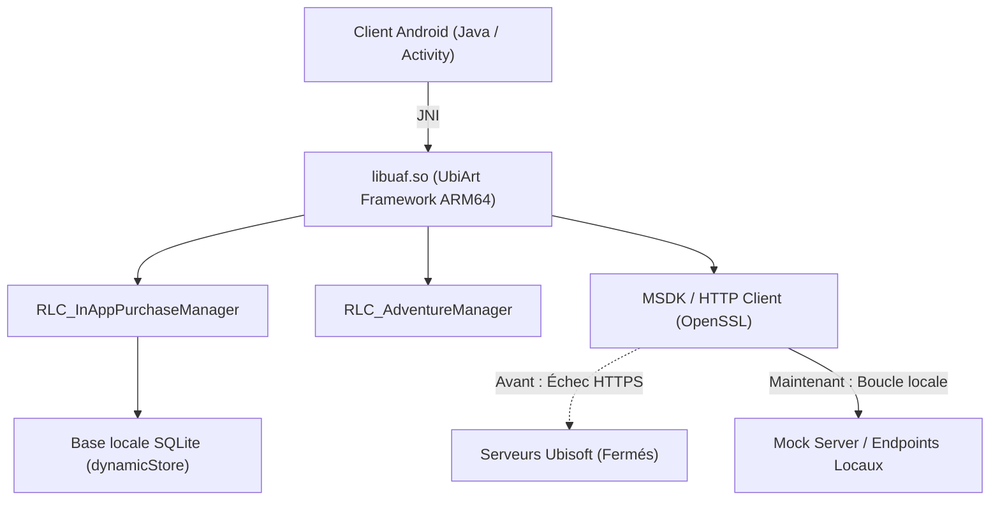

# 🌿 Rayman Adventures Offline — Dossier Technique & Documentation Complète

> **Version cible** : *Rayman Adventures* v4.0.0.2086 (Ubisoft / UbiArt Framework)  
> **Architecture** : Android ARM64-v8a  
> **Statut du projet** : APK autonome validée sur WSA (aucun serveur externe, aucun root) : boutique, tutoriels franchis, 50 000 gemmes, Arbre Sacré.  
> **Dernière mise à jour** : 16 novembre 2026  

---

## 1. Contexte & Justification du Projet

### 1.1. Pourquoi ce projet ?
En 2023, Ubisoft a définitivement coupé les serveurs de **Rayman Adventures**, rendant l'application inopérante pour les joueurs du monde entier. Bien que le jeu soit pour l'essentiel un jeu de plates-formes solo doté d'une direction artistique remarquable (moteur **UbiArt Framework**), ses concepteurs avaient entremêlé le déroulement du jeu avec des appels d'authentification et de validation serveur permanents :
- Vérification de l'intégrité et téléchargement des aventures via DLC ;
- Chargement dynamique du catalogue d'objets (Store V2) ;
- Validation des devises (gemmes, nourriture) et achats d'items (tickets, élixirs) ;
- Horodatage et validation des éclosions d'œufs dans l'incubateur ;
- Événements multijoueur, classements et bannières publicitaires.

À l'arrêt des serveurs, toute nouvelle installation se retrouvait bloquée dès les premiers écrans par des popups d'erreur (*« Échec de la connexion au serveur. Vérifie ta connexion Internet et réessaie »*) ou par des soft-locks dans les tutoriels obligatoires (notamment l'étape 26 de la boutique).

### 1.2. Le But
L'objectif fondamental de ce projet est la **préservation numérique** intégrale du jeu en version autonome :
1. **Émuler ou court-circuiter** les attentes réseau sans dénaturer le gameplay original (ne pas forcer des déblocages arbitraires `canBeActivated` ou altérer la physique du moteur).
2. **Fournir les ressources nécessaires** pour que le jeu soit jouable de bout en bout (gemmes, billets, nourriture).
3. **Produire un package installable universel (APK/XAPK)** fonctionnant sur n'importe quel smartphone ou tablette Android moderne (Android 5 à 14+), sans exiger d'accès root ni de PC serveur à proximité.

---

## 2. Architecture Technique & Rétro-Ingénierie

### 2.1. Le Moteur : UbiArt Framework (`libuaf.so`)
Le cœur du jeu réside dans la bibliothèque partagée native `libuaf.so` (ELF 64-bit LSB shared object, ARM aarch64, taille initiale ~38.6 Mo).  
Cette bibliothèque compile l'ensemble des sous-systèmes :
- **Moteur graphique & Scène** : UbiArt engine (sprites 2D vectoriels/maillés, squelettes d'animation) ;
- **MSDK / UbiServices** : couche de communication réseau HTTP/HTTPS et sockets propriétaires Ubisoft ;
- **DynamicStore / InAppPurchaseManager** : gestion de la boutique et synchronisation avec la base SQLite interne ;
- **AdventureManager / PersistentGameData** : logique de progression de la carte, des œufs et de l'Arbre Sacré.



### 2.2. Cartographie des Domaines Serveurs Ubisoft
L'application tentait de contacter quatre services principaux :

| Domaine | Rôle d'origine | Réponse émulée / Stratégie |
| :--- | :--- | :--- |
| `gamecfg-mob.ubi.com` | Configuration client, version minimale, maintenance | Répond JSON `status: OK`, versions autorisées, pas de maintenance |
| `cp-mob.ubi.com` | Captive portal & ping réseau | Réponse HTTP 200 / 204 instantanée |
| `iap-mob.ubi.com` | Store V2 (catalogue des articles, prix, bannières) | Injection du schéma JSON Store V2 avec articles complets |
| `api-ubiservices.ubi.com` | Authentification joueur, tokens de session, cloud save | Génération de token factice valide, désactivation cloud-sync |

### 2.3. Gestion du SSL / TLS
Dans la version originale, `libuaf.so` utilise une version embarquée d'OpenSSL vérifiant les certificats d'autorité.  
Un patch chirurgical a été appliqué à `0x01a9dcb0` pour forcer la validation positive de toute négociation TLS (`libuaf_emulated.so`), permettant au client de communiquer en HTTPS transparent avec le serveur mock local sans erreur `SSLHandshakeException`.

---

## 3. Inventaire des Correctifs Appliqués (`libuaf_emulated.so`)

Tous les correctifs ont été conçus pour maintenir l'intégrité du moteur de jeu et n'intervenir que sur les goulots d'étranglement réseau et les soft-locks :

| Adresse (VAddr) | Instruction Originale | Modification / Patch | Rôle & Justification |
| :--- | :--- | :--- | :--- |
| `0xd6a240` - `0xd6a28b` | *(Padding nul ELF)* | Code ARM64 (Trampoline) | **Fonctions protégées contre `NULL`** (`0x1a1d650` / `0x1a1d654` → `0xd6a240` / `0xd6a250`) : renvoient 0 au lieu de planter sur une chaîne nulle d'une réponse émulée. **`0xd6a260`** : suite du patch `0x16b2e04` (créature des œufs d'aventure tirée en local, `HatchSimulation`). |
| ~~`0xd6a290` - `0xd6a488`~~ | *(Padding nul ELF)* | *(retiré à l'audit du 16/11/2026, zone remise à zéro)* | Ancienne catégorisation des objets du store par devinette sur l'`item_id` et la 1re lettre du type demandé. Elle répondait « oui » à `isItemOfType(élixir, "easteregg")` : tous les élixirs devenaient des stocks d'œufs de Pâques, donc invisibles (compteurs à 0) et impossibles à créditer. Remplacée par les vrais attributs `ITEM_TYPE` dans le catalogue (voir Phase 1b). |
| `0x175ca54` | `sub sp, sp, #0x50` | `ret` (`c0 03 5f d6`) | Neutralise l'affichage intempestif de `showNeedInternetPopup`. |
| `0x16b3bf4` | `cbz w19, ...` | `b 0x16b3c58` | Court-circuite la vérification de DLC manquant lors de l'accès aux cartes d'aventures. |
| `0x16b2e04` | `b.eq 0x16b2ed4` | `b 0xd6a260` | **Œufs d'aventure** (`HatchSimulationAsync`) : la créature est tirée par le jeu (`HatchSimulation`) au lieu d'une requête serveur. |
| `0x147294c` | `RO2_PersistentGameData_IAP::isInterstitialDisabled` | `mov w0, #1; ret` | **Pas de pubs imposées** (choix du joueur) : la fonction dit si le joueur possède l'achat « sans pub » ; elle est le seul verrou de `MobileSDKModule::cacheInterstitials` / `showMoPubInterstitial` (récap de score, défi, arbre, reprise de l'appli). Les vidéos à récompense choisies par le joueur (« Regarder une publicité » : gemmes, nourriture…) passent par `playMoPubVideo` et restent. |
| `0x17ef014` | `adrp/add` → `"%s/v1/news/%d"` | `adrp/add` → `0xe0b000` | **Actualités** (écran titre) : `GameServerModule::getNewsURL` donne l'adresse ouverte dans la WebView Java du jeu (`rlcWebView`), qui résout les noms par le DNS d'Android, hors des hooks natifs : `rc2.ubi.com` n'existe pas → « Échec de la connexion au serveur ». Nouveau format `http://127.0.0.1:18080%.0s/v1/news/%d` (le `%.0s` absorbe l'URL de base) dans les octets libres `0xe0b000` ; le serveur y sert sa page d'actualités (`News.java`, #13 : événement saisonnier en cours et 3 suivants d'après le calendrier de `SeasonalEvents`, mini-événement du week-end, défi quotidien, en français si l'indice de langue ITF est 1, sinon en anglais). `127.0.0.1` est déjà autorisé en clair par `network_security_config.xml`. |
| `0x169bff8` | `adrp x0, …` (popup) | `b 0x169c06c` | **Classement** (`RLC_GS_Leaderboard::initialiseOnlineProfiles`) : quand les réponses ne nomment aucun autre joueur (le joueur local est exclu de cette liste), le jeu affichait « Échec de la connexion au serveur ». Hors ligne le joueur est toujours seul : on garde le chemin d'origine (listes marquées terminées) sans la popup ; l'écran montre le joueur seul (Amis / Pays / Monde). |
| `0x170aad4` | `cbz w0, ...` | `nop` (`1f 20 03 d5`) | Permet la dépose d'œuf dans l'incubateur sans validation serveur. |
| `0x175b1e0` | `cbnz w0, 0x175b284` | `b 0x175b284` | **Dépôt d'œuf** (`beforeDropEggOnIncubator`) : toujours via le serveur (`incubator/startIncubation` → `dropEggOnIncubator(hatchingDuration)`). L'ancien `nop` forçait une incubation purement locale ; le `incubationStatus` suivant (« incubateur vide ») faisait alors disparaître l'œuf (`flushIncubator`). |
| `0x17c1188` | `cbz w23, 0x17c1260` | `b 0x17c1260` | **« Éclore maintenant »** (gemmes) : toujours via `incubator/useElixir(5)`, sinon l'œuf restait sur le serveur et revenait. (L'ancien `nop` forçait le chemin local.) |
| `0x17c2a4c` | `cbz w0, 0x17c2a98` | `b 0x17c2a98` | **Tap sur un œuf prêt** : pendant le tutoriel le client le prenait localement sans prévenir le serveur ; maintenant toujours `incubationStatus(autoHatch)`. |
| `0x175c3c8` | `eor w2, w2, #1` | `mov w2, #1` | La requête `incubationStatus(autoHatch)` part en arrière-plan (RequestType 1) : pas de popup « Une erreur est survenue sur nos serveurs » sur la réponse 410. |
| `0x17b9b2c` | `cmp w0, #0x1f3` | `b 0xe0af00` | **Œuf inconnu du serveur** (HTTP 410) : l'œuf local est conservé, et sur une demande `autoHatch` le client le fait éclore lui-même (`pickEggFromIncubator`) — œufs incubés par les anciennes versions. Code dans `scripts/incubator_hooks.py`. 409 est inutilisable (lu comme « une sauvegarde plus récente existe sur le serveur »). |
| `0x1687964` | `ldr w1, [x19, #4]` | `b 0xe0ac6c` | **Charlie** : créature de l'œuf caché choisie par le jeu (`scripts/egg_pick_hooks.py`). |
| `0x16e3b7c` | `ldr w1, [x1, x22]` | `b 0xe0ac00` | **Loupe** : créatures des œufs des prochaines aventures choisies par le jeu. |
| `0x169dea0` | `ldr w1, [x21, #0xa4]` | `b 0xd6a2a0` | **Œuf gagné au ticket**, écran de grattage : la créature est choisie (`HatchSimulation`, rareté tirée par le serveur) **avant** que le jeu colore l'œuf gratté avec `getCreatureRarity(creatureID)`. Sans ça, `creatureID` invalide → rareté 6 : l'œuf affiché ne correspondait pas à la créature reçue (corrigé le 16/11/2026, `scripts/ticket_hooks.py`). |
| `0x171a774` | `ldr w0, [x19, #0xa0]` | `b 0xd6a290` | **Œuf gagné au ticket**, réclamation : même choix en secours (ne fait rien si la créature est déjà choisie au grattage). |
| `0x17b9864` | `cmp w23, w0 ; b.eq` | `b 0xe0af2c` | **Œuf ré-tiré par un élixir** : les élixirs argent / or / nouvelle créature relancent le tirage de l'œuf côté client (`requestAsyncElixir` → `RLC_CreatureManager::HatchSimulation`, local depuis le patch historique `0x16b2e04`) sans prévenir le serveur ; à l'éclosion le client remplaçait son œuf par celui du serveur (le commun d'origine). L'œuf du serveur n'est plus adopté que si le client n'en a pas. |
| ~~`0x1841cb8`~~ | *(Prologue fonction)* | *(retiré le 16/11/2026)* | Ancien « solde hors-ligne » : `getUserGems` renvoyait toujours 50 000 (compteur figé, gains et dépenses invisibles). Les gemmes sont redevenues réelles. |
| ~~`0x1646480`~~ | `cbz w0, 0x16464a0` | *(retiré le 16/11/2026)* | Ancien contournement du contrôle de solde de `tryBuy`. |
| `0x1a9dcb0` | Vérification X509 | Bypass TLS | Validation inconditionnelle des certificats HTTPS. |
| `0xc6eb80` | PLT `getaddrinfo` (`adrp x16, GOT`) | `b 0xe0a080` | **Hook DNS** : tout hôte se terminant par `ubi.com` est résolu comme `127.0.0.1`. |
| `0xc6e980` | PLT `connect` (`adrp x16, GOT`) | `b 0xe0a0e0` | **Hook ports** : `127.0.0.1:80` → `:18080`, `127.0.0.1:443` → `:18443` (ports < 1024 interdits sans root). |
| `0x1c03b54` | `OpenSSLCertificateValidator::isVerifyRequired` | `mov w0, #0; ret` | **TLS UbiServices** : le SDK installe son propre callback X509 (avec pinning) que le patch curl ne couvrait pas (`TLSV1_ALERT_UNKNOWN_CA`). |
| `0x1e1423c` | `"https://rc.ubi.com"` | `"http://rc2.ubi.com"` | **URL du serveur de jeu** (même longueur) : HTTP clair, résolu en 127.0.0.1 par le hook DNS, port 80 → 18080. Un littéral IPv6 `[::1]` n'est pas accepté par le client HTTP UbiServices. |
| `0x17fb2c8` | `adrp/add` → `""` | `adrp/add` → `"Prod"` (`0x1df07d8`) | **Environnement du GameServerModule** : sans entité `nodeConfig`, le nom d'environnement restait vide et la connexion échouait en boucle (« Connexion au serveur… »). |
| `0x16e4190` | `b 0x16e4220` | `nop` | **Fin de synchro créatures** : le serveur embarqué envoie un `profileId` distinct pour éviter `reconcileServerCreatures` (qui remplacerait les créatures locales et forcerait un redémarrage, erreur `0x10010601`) ; sans ce patch le drapeau « synchro en attente » (`RLC_AdventureManager+0x69c`) restait levé → erreur `0x10040602` sur toute action d'incubateur. |
| `0x17f01e0` | `GameServerModule::verifySignature` | `mov w0, #1; ret` | **Signature RSA des réponses** (`rlc-hash` sur corps + `;id=` + `rlc-msg-id`) : clé privée Ubisoft perdue → toujours valide. |
| `0xe0a080` - `0xe0a179` | *(zone nulle non référencée de .text)* | Code ARM64 + chaînes | Corps des deux hooks ; appel de la vraie fonction libc via le slot GOT d'origine (`0x24a7478` / `0x24a7378`). |
| `0xe0ac00` - `0xe0affb` | *(même zone nulle)* | Code ARM64 | Œufs Charlie / loupe (`0xe0ac00`, `scripts/egg_pick_hooks.py`), incubateur (`0xe0af00`, `scripts/incubator_hooks.py`). Les œufs des tickets sont à `0xd6a290` (zone nulle libérée par l'ancien hook `isItemOfType`, `scripts/ticket_hooks.py`). Les hooks de débogage (`--debug`) occupent `0xe0a200`-`0xe0ac00`. |

---

## 4. Analyse du Soft-Lock Boutique & Résolution

### 4.1. Le Problème Rencontré
À l'étape 26 du tutoriel (achat obligatoire d'un ticket surprise), le joueur cliquait sur le ticket à 100 gemmes. Le jeu gelait et affichait :  
> *« Échec de la connexion au serveur. Vérifie ta connexion Internet et réessaie. »*

### 4.2. La Chaîne de Causalité Découverte
1. `RLC_LuckyTicketShopMenu::onClickScrollingButton` (`0x169a728`) appelle `tryBuyLuckyTicketPack` (`0x169a518`).
2. Cette fonction appelle `RLC_InAppPurchaseManager::tryBuy` (`0x1646420`), qui compare le prix (100) aux gemmes actuelles retournées par `getUserGems` (`0x1841cb8`).
3. Comme le profil local n'avait pas encore accumulé de gemmes (0 gemme en caisse), `tryBuy` renvoyait `0` (échec).
4. `tryBuyLuckyTicketPack` sautait alors vers `openNotEnoughGemsPopup` (`0x1681284`).
5. Dans cette fonction, le jeu cherchait des packs de gemmes payants (`RLC_GemsPack`) pour proposer au joueur d'en acheter. Ne trouvant aucun pack IAP disponible hors-ligne, le code déclenchait le message d'erreur d'urgence ID `0x1d6` (*« Échec de la connexion... »*).

### 4.3. La Solution
En configurant `getUserGems` pour retourner 50 000 gemmes et en neutralisant le saut conditionnel d'échec dans `tryBuy`, l'achat a été validé instantanément en local :
- La séquence de grattage *"Gratte-moi bébé !"* s'est déclenchée.
- Les récompenses (élixirs) ont été créditées.
- Le tutoriel s'est débloqué et la main indicatrice a disparu.
- L'Aventure 17 est devenue accessible.

---

## 5. État Actuel des Fonctionnalités Validées

| Élément de Jeu | Statut | Preuve Visuelle (captures de la première phase, non conservées) |
| :--- | :---: | :--- |
| **Boot & Écran Titre** | ✅ Opérationnel | `screen_menu.png` |
| **Affichage du Portefeuille (50 000 Gemmes)** | ✅ Opérationnel | `screen_map.png` |
| **Rayons de la Boutique (Tickets dorés)** | ✅ Opérationnel | `screen_tickets.png` |
| **Mini-jeu Tickets ("Gratte-moi bébé !")** | ✅ Opérationnel | `screen_ticket_scratch.png` |
| **Fin du tutoriel étape 26 & Carte libre** | ✅ Opérationnel | `screen_map_clean.png` |
| **Arbre Sacré (150m, navigation branches)** | ✅ Opérationnel | `screen_tree_families.png` |
| **Profil Joueur & Succès** | ✅ Opérationnel | `screen_rayman_tapped.png` |

---

## 6. Feuille de Route : Ce qu'il reste à faire

Pour finaliser le projet et livrer un fichier installable prêt à l'emploi sur n'importe quel appareil Android :

### Phase 1 : Autonomie Totale Sans Dépendance Réseau Externe — ✅ TERMINÉE (16/11/2026)
Auparavant, les domaines `*.ubi.com` étaient redirigés vers `10.0.2.2` via `/system/etc/hosts` (root) et servis par `mock_server.py` sur le PC.

**Implémentation retenue :**
1. **Hooks natifs dans `libuaf.so`** (`scripts/net_hooks.py`) : les stubs PLT de `getaddrinfo` et `connect` sautent vers un code cave. curl et OpenSSL étant liés statiquement dans `libuaf.so`, toutes leurs résolutions/connexions passent par ces deux PLT.
2. **Serveur mock embarqué** (`offline_server/`, Java, `classes5.dex`) : `OfflineServerProvider` est un `ContentProvider` déclaré dans le manifeste ; Android l'instancie au démarrage du processus, avant toute Activity. Il lance `OfflineServer` (HTTP/1.1 keep-alive, `Expect: 100-continue`, chunked) sur `127.0.0.1:18080` et un `SSLServerSocket` sur `127.0.0.1:18443`. Les routes sont un portage exact de `mock_server.py` ; la config Houston pointe désormais vers `http://127.0.0.1:18080/`.
3. **Certificat TLS** : PKCS12 auto-signé `*.ubi.com` généré par keytool en mode *legacy* (3DES/HmacSHA1) — le format PBES2 par défaut des JDK récents n'est pas lisible par le BouncyCastle d'Android. Accepté côté client grâce au bypass X509 (`0x1a9dcb0`).
4. **Manifeste binaire** (`scripts/patch_manifest.py`) : ajout du `<provider>` directement dans l'AXML (clonage de l'élément `ZipFileContentProvider`, 2 chaînes ajoutées au string pool) — pas d'apktool ni de recompilation des ressources.

**Validation (WSA, PC mock non sollicité)** — `adb logcat -s RaymanOffline` :
```
[https://gamecfg-mob.ubi.com] GET /?product=708&portal=Google&version=3.9.95 -> 200
[https://iap-mob.ubi.com] GET /store/v2/?product=708&portal=Google&country=FR&language=fr&... -> 200 (102740B)
[https://cp-mob.ubi.com] GET /?product=708&language=fr&country=FR -> 200
```
Écran titre, carte Aventure 17 (50 000 gemmes) et boutique complète : `screenshots/screen_standalone_*.png`.

**Points restants connus :**
- `NetworkCoreAndroid` (Java) interroge `https://rc.ubi.com/v1/deviceconfig/...` via `HttpsURLConnection`, hors des hooks natifs : échec TLS/réseau géré proprement, le jeu utilise sa config par défaut. À traiter éventuellement côté Java si un effet visible apparaît.
- L'APK est re-signée (`offline_testkey.jks`) : elle ne peut pas mettre à jour une installation Ubisoft d'origine (désinstallation préalable nécessaire, la progression locale est perdue sauf sauvegarde root).

### Phase 1b : Services en ligne émulés (UbiServices + serveur de jeu RLC) — 🚧 EN GRANDE PARTIE FAIT (16/11/2026)

**Chaîne de connexion désormais fonctionnelle** (validée par instrumentation `Module::setState`) :
`NetworkModule → LoginModule → UbiServicesModule_SDK → GameServerModule → userProfileModule / incubatorModule / luckyTicketModule / dailyRewardsModule / storePacksModule / rlcChallengesModule / …`

1. **UbiServices** (`https://public-ubiservices.ubi.com`, serveur TLS embarqué) :
   - `POST /v2/profiles/sessions` → `SessionInfo`. Champs obligatoires (masque de présence `0xeff` dans `SessionInfo::parseJson`) : `ticket`, `profileId` (GUID), `hasAcceptedLegalOptins` (bool), `spaceId`, `environment`, `expiration`, `serverTime`, `clientIp`, `sessionId` (GUID), `platformType`, `accountIssues` (tableau).
   - `GET /v1/applications/{appId}/configuration` → `ConfigInfo` (table de liaison `0x24dd100`) : `platformConfig`, `resources`, `legacyUrls`, `sandboxes`, `uplayServices`, `punch`, `sdkConfig`, `featuresSwitches`, `gatewayResources`, `custom`.
   - `featuresSwitches` = `[{"name":…, "value":false}]` : on coupe ce qui n'a pas de sens hors-ligne (websocket `Connection`/`WebSocketClient`, `Event`, `News`, amis, Uplay, `EntitiesSpace`…). Noms : `FeatureSwitchId::getString` (`0x1c18200`).
2. **Serveur de jeu RLC** (`http://rc2.ubi.com` → `RlcApi.java`) : requêtes `POST /v<N>/<module>/<action>` au format JSON ITF ; réponses désérialisées par `ITF::SerializerJson` (conteneurs = tableaux JSON, maps = `[{"KEY":…,"VAL":…}]`), en-têtes `rlc-hash` et `rlc-time` (ISO-8601) requis.
   - ✅ `v1/userprofile/session` (`StartSession`) → `online::SaveInfo` : `pid`, `slot`, `saveUniqueId`, `forceNewGame`, `save`, `msdkData`, `saveGameVersionFormat`, `populations`, `iap`, `iapPrediction`, `reco`.
   - ✅ `v1/userprofile/save` : le client envoie tout son profil (format JSON ITF, ~31 Ko, dont le blob chiffré `save`) **avant** de demander créatures/incubateur → stocké dans `files/rlc/profile.json` (`ProfileStore.java`), première copie dans `profile_initial.json`. L'incubateur reste sous l'autorité du serveur (non écrasé par les uploads).
   - ✅ `v1/userprofile/creatures` → `PlayerCreatureList` (`creatures`, `incubationData`, `profileId`, `iapScore`, `joinDate`, `devTeam`, `onBoardingFinished`). Le champ `creatures` de l'upload est vide (les vraies créatures sont dans le blob chiffré) : `profileId` volontairement différent du pid local → pas de réconciliation, les créatures locales font foi (+ patch `0x16e4190`).
   - ✅ `luckyTicket/getReward|consumeTicket|getDecoyReward|getVideoReward` → `getRewardResult {"reward": RLC_LuckyTicketReward}` (`Rewards.java`). **Tirage avec les tables d'Ubisoft** (vérifié le 16/11/2026) : elles sont dans les données du jeu (`RLC_InAppPurchaseManager_Template` : `ticketCategoryWeights{Simple,Golden,Chocolate}`, `ticketNormalRewardWeights*`, `ticketJackpotRewardWeights*`, `ticketEggRarityWeights*`), le client ne s'en sert pas (le tirage était côté serveur). `tools/re/dump_ticket_weights.py` les lit dans la mémoire du jeu (root) → `mock_data/ticket_weights.json` → asset du serveur. Ticket simple : catégorie Normal 10 / Jackpot 2 / Œuf 1 ; doré : 9 / 2 / 1 ; chocolat : 8 / 0 / 1. Lecture : 1re ligne `_unknown` des tables Normal = gemmes (25/30/35 en simple), poids 0 ignorés, doublons des tables de rareté (clé 16) ignorés. 200 000 tirages par type de ticket (`/offline/admin/drawTickets`) : fréquences conformes aux poids (ex. ticket simple, gemmes 25 attendu 12,4 % → 12,46 % ; œuf commun 5,1 % → 5,20 %).
     - Le client garde (affiche puis crédite) la réponse de `getReward` ; `consumeTicket` décrémente le compteur et un `creatureID` valide dans sa réponse transformerait le ticket en cet œuf → `consumeTicket` renvoie la même récompense.
     - `creditReward` : Gems, Food, Elixirs (`count` de chaque `elixirType0..2` non nul), AllElixirPack, LuckyTicket/GoldenTicket, MagnifyingGlass, ChallengeToken, SeasonalCurrency. **`TwoElixirs` (12) et `ThreeElixirs` (13) ne créditent rien** (l'ancienne table maison donnait « 2 élixirs » 15 % du temps → perdus).
     - **Œufs** (type 9) : éclos directement à partir de `creatureID`. Le serveur ne tire que la rareté (dans `elixirType0`, `creatureID` invalide) ; le hook `scripts/ticket_hooks.py` (`0x169dea0` au grattage, `0x171a774` en secours à la réclamation) fait choisir la créature par le jeu dès l'ouverture du grattage (l'œuf gratté prend la couleur de sa rareté : bronze commun, argent peu commun, or rare), `RLC_CreatureManager::HatchSimulation(acquisition, région courante, rareté, false)`, comme le générateur de debug des développeurs `RLC_InventoryManager::DEBUG_generateLuckyTicketReward`.
     - Validé en jeu : œuf rare forcé → « NOUVEAU ! Pouss' Pouss' (Les Botaniques) — Rare » ; 2 élixirs d'or → compteur 1 → 3 ; ticket doré normal → 50 gemmes. Outil : `/offline/admin/forceTicket?type=9&e0=2` (prochain ticket imposé).
     - Le grattage montre la récompense gagnée 3 fois et 3 leurres (`RLC_GS_LuckyTicket::initRewardTypes`, côté client) : on ne gagne que le symbole présent 3 fois.
     - Base créatures (380 : 101 communes, 104 peu communes, 115 rares, 60 reines ; familles 32-33, 40-63 saisonnières/événements) exportée dans `mock_data/creatures.json` (`RLC_CreatureManager+0x588`).
   - ✅ `incubator/*` (`Incubator.java`) : `startIncubation` (30 min), `useElixir` (accélération = temps restant ÷ 2 par élixir, `HatchNow` = 0), `incubationStatus` ; **éclosion** = `incubationStatus(autoHatch:true)` une fois le temps écoulé → réponse `autoHatch:true` + `creatureId` → rituel d'éclosion côté client. Validé : « Œuf sauvé ! » → incubateur → « NOUVEAU ! Flore (Les Botaniques) » → « Famille complète ! », arbre sacré 150 m → 190 m (`screenshots/screen_offline_*.png`).
   - ✅ **Synchronisation de l'incubateur** (corrigée le 16/11/2026 après un retour de test : « l'œuf disparaît quand on appuie dessus ») : chaque réponse `incubationStatus` fait autorité côté client — `creatureId` « aucune créature » ou HTTP 404 ⇒ `flushIncubator()` (l'œuf est supprimé), `creatureId` différent ⇒ l'œuf local est remplacé. Or l'ancienne liste de patchs incubait localement (dépôt, « éclore maintenant », tap sur œuf prêt pendant le tutoriel), sans jamais prévenir le serveur. Désormais tous ces chemins passent par le serveur (patchs `0x175b1e0`, `0x17c1188`, `0x17c2a4c`), et le serveur répond **HTTP 410** (« œuf inconnu ») quand il n'a pas d'œuf : le client garde son œuf local et, sur une demande d'éclosion, le fait éclore lui-même (`scripts/incubator_hooks.py`). Validé : œuf incubé par une ancienne version conservé puis éclos (« NOUVEAU ! Flore ») sans popup ; œuf connu du serveur affiché puis éclos via `autoHatch` (« NOUVEAU ! Borve »). Élixirs : seuls accélération (1) et « éclore maintenant » (5) passent par `incubator/useElixir` ; argent (2), or (3) et nouvelle créature (4) relancent le tirage côté client, et l'œuf local fait foi à l'éclosion (patch `0x17b9864`). Validé : œuf commun + élixir d'or → « NOUVEAU ! Sètede (Les laineux) — Rare ». Le dépôt d'un nouvel œuf (`startIncubation`) a aussi été vu fonctionner en jeu. 
   - ✅ **Gemmes réelles** (16/11/2026, choix du joueur) : les patchs historiques `getUserGems` = 50 000 et `tryBuy` sans contrôle de solde sont retirés ; le compteur lit le stock `RLC_GemsStock` (créé grâce aux attributs `ITEM_TYPE`). Trois copies du solde : la table interne du SDK mobile (`std::map<char*,char*>` « id d'objet → quantité en texte » dans l'instance `0x2521a50`, +0xb8, source de vérité, sauvegardée par le SDK à chaque transaction), sa liste des objets possédés (`dynamicStore+0x448`, quantité à +0x28) et les stocks `RLC_InventoryItem` (`dynamicStore+0x478`, quantité à +0xc), recopiés depuis la table après chaque transaction. Le joueur avait 33 gemmes réelles : solde porté une fois à 50 000 en écrivant les trois copies (`tools/re/memread.py`, root), puis achat d'un élixir → 49 915, conservé après redémarrage. Hors ligne, manquer de gemmes ouvre la boutique de gemmes payantes, qui affiche « Échec de la connexion au serveur ».
   - ✅ **Catalogue de la boutique** (`build_offline_server.write_store_catalog`, appliqué à `mock_data/store_v2_fixed.json`) : 1) chaque objet reçoit `"params": [{"key": "ITEM_TYPE", "value": …}]` (`gems`, `ELIXIR_UNCOMMON`, `ELIXIR_ANYTHING`, `elixir_skip_time_50`, `elixir_force_new_creature`, `luckyticket`, `golden_lucky_ticket`, `Food`, `costume_rayman`…), lu par `dynamicStore::isItemOfType` pour choisir le stock d'inventaire ; 2) côté « reçu » (`get.items`), `item_id` et `amount` sont des **chaînes** : le parseur MSDK (`0x19f8f20`) fait `atoi` sur la valeur texte, un nombre JSON donnait une quantité 0 (tout achat en gemmes ne créditait rien). Validé : achat d'un élixir d'or → `creditItem id=2102 amount=1`, compteurs affichés (le joueur possédait déjà des élixirs, invisibles jusque-là).
   - ✅ `dailyRewards/*` (`DailyRewards.java`, géré par `RLC_SocialManager`) : `getReward` → `getDailyRewardResult {"reward": uint}` (≠ 0 = cadeau disponible, le menu « Cadeau quotidien » s'ouvre ; le contenu du cadeau vient de la config locale `RLC_InAppPurchaseManager::getDailyRewards`), `consumeReward` → `{}` puis le client crédite. Un cadeau par jour calendaire local. Validé : « Cadeau quotidien — 5 gemmes ou 10 gemmes (pub) ».
   - ✅ `challenges/*` — **Défi quotidien** (runner « Mini-marathon », `Challenges.java`, géré par `RLC_ChallengeManager`) :
     - `getInfos` → `online::challengeInfos` : `seed`, `timeLeft`, `eventTimeLeft`, `thresholds`, `difficultyThresholds`, `continueParams`, `mapPath`, `configPath`, `disabledBricks`, `leaderboardRewards[challengeRewardList{maxRank, minRank, rewards[challengeReward{type, count, elixirType, costumeName}], maxPercent}]`, `canCollect`, `challengeRank`, `challengeDate`, `challengeTotalPlayers`, `tokenCount`, `tokenRechargeTimer`. `mapPath`/`configPath` vides → valeurs du template client (`World/challenge/Run/ChallengeRun`) ; `thresholds` vides → tirés du template avec la graine ; `continueParams` vides → valeurs par défaut de la sauvegarde. Le serveur ne pilote donc que la graine (une par jour local), la durée, les jetons (`tokenCount` = plafond, `tokenRechargeTimer` = secondes par jeton, la recharge est faite par le client) et les récompenses.
     - `postChallenge {score}` → `challengeScoreResult {updated}` ; `leaderboardConfig` → `{playerRank, totalPlayers}` ; `leaderboard {leaderboardRanges}` → `challengeLeaderboardData {entries[challengeScoreEntry{name, pid, checkpid, score, stars, costume, img, country, rank}]}` ; `setCollected` → `{}`.
     - Hors ligne le joueur était seul au classement (rang 1/1) ; depuis le #12 il est classé parmi des joueurs fictifs (voir plus bas). Le lendemain, `canCollect` + `challengeRank` donnent la récompense du palier (choix : 25 gemmes + 1 ticket chanceux, + 150 de monnaie pendant un marathon ; 5 jetons max, 1 jeton / 30 min).
     - Validé : participation, run, « Revive » (gemmes), score 98 « Meilleur score ! », classement « 1 🇫🇷 AVENTURIER 558971 — 98 », puis « Encaisser » le lendemain (simulé avec `ageChallenges`) → ticket +1.
   - ✅ `ghosts/*` (`Ghosts.java`, `ITF::GhostManager`) : `uploadGhost {data: base64}` → stocké ; `getGhost` → `rlcGhostData {data}` = dernier run du joueur (le client vérifie lui-même qu'il correspond au défi du jour). Sans fantôme : **HTTP 404** obligatoire → `onGetOnlineGhostFail` lance le run sans fantôme ; un `data` vide bloquerait le bouton « Participer ».
   - ✅ Réponses bien formées sans logique : `messaging/get_*` → `{"messages":[]}`, `userprofile/getPlayerCluster` → `{"clusterName":""}`, `userprofile/sns` → `{}`, `incubator/startNextAdventure` → `{}` (GameServerEmpty).
   - ✅ **Œufs choisis par le jeu** (`scripts/egg_pick_hooks.py`) : quand le serveur répond un `creatureId` invalide avec la rareté 6 (`Creature_Rarity::unknown`), le jeu choisit lui-même avec `RLC_CreatureManager::HatchSimulation` (tirage de rareté par ses propres poids, puis retrait des régions verrouillées, familles saisonnières et doublons — comme pour les œufs d'aventure ordinaires).
     - `incubator/getCharlie(region, forceCharlie, …)` → `charlieResult {charlie, charlieCreatureId, decoyRewardType, decoyReward}` : un œuf caché supplémentaire dans l'aventure, 1 aventure sur 4 en moyenne (notre choix, `Incubator.CHARLIE_EVERY` ; `/offline/admin/forceCharlie`). Hook `0x1687964`, région = `RLC_AdventureManager::getCurrentAdventureRegion()`. Validé : « Charlie » → `HatchSimulation(acq 2, région 2, rareté 6)` → Radar_Fluffy_3.
     - `incubator/magnifyingGlassNextAdventure(regions, previousResult, exclude, forcedRarity, forceNewCreature)` → `{results:[HatchSimulationResult]}`, un par région (œufs des prochaines aventures). Hook `0x16e3b7c`. Vérifié statiquement seulement (la loupe ne se déclenche que dans le déroulé de la carte).
   - ✅ **Classement / arbre** (`Leaderboards.java`, `RLC_LeaderboardManager`, ajouté à l'audit du 16/11/2026) : `leaderboards/postLeaderboard {is_map, map_id, score, is_time_attack, map_seed}` → meilleur score gardé dans `state.json` ; `leaderboards/getLeaderboard {is_map, map_id, players_type, select_type, start, count, rank}` → `ScoreList {scores[ScoreEntry{player, score}], rank{score, rank, percent}}` (le joueur seul jusqu'au #12, des joueurs fictifs depuis) ; `userprofile/getShortProfiles {profileId[]}` → `userProfileShortList {profiles[{pid, name, deviceCountry, stars, costume, img}]}` et `userprofile/getUserProfile` → profil stocké (sans le blob `save`). Avant l'audit ces requêtes recevaient `{"status":200,"result":"ok"}` et l'écran « Classement » affichait « Échec de la connexion au serveur » (patch `0x169bff8`). Validé : Monde / Pays / Amis → « AVENTURIER 558971 — 200 m », sans popup.
   - ✅ **Événements saisonniers** (`SeasonalEvents.java`, 17/11/2026) : le jeu est livré **sans** événement (`enginedata/gameconfig/seasonaleventconfig.isg` : `currentSeasonalEventID2` = 0, dates nulles). Ubisoft programmait l'événement courant en surchargeant ce template via `GET gameglobals/getGameGlobals` → `gameGlobalsContainer {data}`. Format retrouvé :
     - `data` est **chiffré** (`StartEncryption("data", TeaKey)`) : chaîne base64 du JSON chiffré en XXTEA, clé `2d8441f7 e30865fc c9f5b992 03bb7669` (vérifié en déchiffrant `enginedata/online/gameglobals.isg.ckd`, qui contient les vraies surcharges d'Ubisoft : prix, poids des tickets…).
     - `gameGlobalsData {variables, overrides, versionTime}` ; les **maps ITF en JSON sont des objets** dont le nom de membre est la clé (StringID en chiffres) et le membre la valeur. Clé = StringID du chemin (`tools/re/stringid.py`, lookup2 de Jenkins sur le texte en majuscules) : `584237580`.
     - Surcharge = `{json, condition {conditions: [], needAll, priority, hotReload}, name}`, `json` à plat avec `_CLASS_NAME`, comme Ubisoft. Appliquée au chargement du template (lancement suivant).
     - Dates en **UTC** (comparées à `getCurrentServerTimeUTC` ; l'offset est ignoré par `fromISO8601`). `meta.gameGlobals.versionTime` change avec chaque événement, ce qui fait télécharger les globals.
     - Événements (`getEventType`) : chasses 1, 2, 3, 4, 5, 6, 9 ; roues 7, 10, 13, 17 ; marathons 8, 11, 12, 16 ; 14 et 15 ne sont pas des événements. **Vérifiés en jeu un par un (#6, 18/11/2026)** : le jeu n'embarque que l'habillage du **dernier** événement de chaque type, réutilisé par tous les id du type : chasse 9 « La chasse au trésor de Raybarbe » (doublons ; Ticket Jolly-Roger, Œuf englouti, costume Raybarbe), roue 17 « Expédition Rayhistorik » (viande ; boutique « Maglace-Zin » : Ticket Fourrure, Œuf gelé, Barbarrrrr), marathon 16 (« Échoppe » : Ticket Parchemin, Châtoeuf, Raystidigitateur). Ce qui change avec l'id : le costume réellement vendu (`getCurrentSeasonalEventCostume`, table par id, retrouvé par StringID dans le catalogue) avec son prix, et les familles de Bouboules (l'Œuf gelé de la roue 10 a donné un « Pou » des Bouhooooouuuu). La carte de la boutique garde l'image et le nom du costume du dernier événement. Costumes : 1 Teensy_Bunny (2000), 2 Globox_Summer, 3 Globox_Halloween (1900), 5 Barbara_Winter, 6 Rayman_Renaissance, 7 Globox_Glombrero, 8 Rayman_Raybolt, 9 Rayman_Raybeard (= Raybarbe), 10 Barbara_Hellen, 11 Globox_Egyptian, 12 Barbara_Sakura, 13 Rayman_Spaceray, 16 Rayman_Raywiz (= Raystidigitateur), 17 Barbara_IceAge (= Barbarrrrr, 3200) ; les autres à 2500. L'id 4 n'a pas de costume (vendu 0, œuf « Famille complète ») et reste hors calendrier.
     - ✅ **Carte du costume corrigée** (`scripts/costume_card_hooks.py`, 18/11/2026) : la carte (nœuds `costumeButton` / `pack3Name` / `*visuals` des écrans `menuhuntevent.isc`, `menuchallengewheelevent.isc`, `endlessrunnerevent/eventmenu.isc`) gardait le titre et l'image du costume du dernier événement, alors que l'achat (`purchaseCostume(getCurrentSeasonalEventCostume())` puis `selectCostumeId`) donne et équipe le costume de l'id. Hook en fin de `refreshCurrentEventScreenCostume` (`0x1772fa8`, cave `0xef8300`) : titre = `UITextBox` de `pack3Name` → `setLocId` (vtable +0x1c8) avec `RLC_InAppPurchaseManager::getCostumeNameId(costume)`, le nom affiché par la boutique de costumes. L'image (acteur `hunteventvisuals` / `challengewheelvisuals` / `endlessrunnereventvisuals`, lié à `costumeButton`, trouvé par `Actor::getChildActor`) n'existe que pour le costume du dernier événement : elle est masquée (`AIUtils::hide`) pour les autres costumes, à chaque image de `updateCurrentEventScreen` (`0x17c5cf8`) car la transition d'ouverture du menu réaffiche ses enfants. Validé : chasse 1 « Pti'lapin » 2000, marathon 11 « Sandbox » 2500, roue 13 « Ray-One » 2500 (cartes sans image), chasse 9 « Raybarbe » avec son image ; aucun plantage.
     - ✅ **Vraie image du costume** (18/11/2026, `costume_card_hooks.py`, routines `icon_source` en `0xef8900`) : un acteur de `world/common/ui/common/dynamicpackcostume/dynamiccostumes/dynamiccostumesendless.tpl` (76 icônes, costumes d'événement compris ; chaque animation porte le StringID du costume, ex. `raymanspaceray.anm` ↔ 0x97423f29 « Rayman_Spaceray ») est créé sur la carte par `WorldManager::spawnActor` (`SpawnActorInfo` : +0x20 position, +0x38 chemin, +0xa0 scène = `getWorld()->getRootScene()+8` du bouton, +0xe0 bit 4), dans la scène du menu (il disparaît avec lui). Il se charge en asynchrone : lié au bouton seulement une fois prêt (`+0x10` bit 7 et `+0x258` bit 3, comme `ActorSpawner::checkReadyAndRegister` ; lié trop tôt, `BindHandler::update` plantait sur un enfant sans `Bind`), via `Actor::createParentBind(false, bouton, 0, 0, true, false, false, false)` comme les drapeaux de `RO2_UIItemCompetitorsComponent`, masque d'affichage UI du bouton, échelle = celle du bouton ×1,5 (champ `+0x48` du `Bind` remis à 0 : sinon `BindHandler::updateWorldCoordinates` recopie l'échelle du parent à chaque image et l'icône restait petite), puis `setAnim(StringID du costume)` (vtable +0x1e8) et `AIUtils::show` ; rappelé à chaque image de l'écran. Son `ObjectRef` est gardé dans la fin inutilisée de la dernière page de `.bss` (`0x253af00` ; le segment RW finit en `0x253a6d8`). `getDynamicSlotCostumeIconAnimationID` donne les noms du petit `dynamiccostumes.tpl` (packs spéciaux) et se trompe pour les costumes d'événement (« raymanraybolt » pour Rayman_Spaceray). Validé (WSA) : chasse 3 « Glombie », roue 13 « Ray-One », marathon 11 « Sandbox » avec leur image ; chasse 9 garde son image d'origine ; rien ne reste sur la carte en quittant l'écran.
     - Autres pistes (non retenues) : les icônes de tous les costumes existent dans `world/common/ui/common/dynamicpackcostume/dynamiccostumes/dynamiccostumesendless.tpl` (75 `.pbk`, ex. `barbarahellen.pbk`), l'animation d'un costume = `RLC_InAppPurchaseManager::getDynamicSlotCostumeIconAnimationID(costume)` (`PlayerIDInfo+0x50`), posée par `setAnim` (vtable +0x1e8) sur l'`AnimLightComponent` du nœud `iconCostume` des « dynamic pack slots » (`updateDynamicPackSlot`). Le nœud image de la carte d'événement n'a que l'atlas du dernier événement. Deux voies : faire apparaître un acteur de ce template sur la carte à l'exécution (`WorldManager::spawnActor` / `ActorSpawner`, chargement asynchrone, liaison au bouton), ou livrer des données corrigées par le **système de patchs du moteur** : `DlcManager::initialPatchDetection` cherche des dossiers `dlc/patch_*` contenant `patchdescription.xml` (`Version`, `Files`, `MinimalEngineVersion`, `RequiredPatches`, `InvalidatedPatches`, `NeedEngineReset`) et enregistre leurs `.ipk` en priorité (`registerPatchBundle`, `HeaderRegistry::searchFileInPatch`), ce qui éviterait de toucher à l'OBB déjà installé.
     - Calendrier = 14 créneaux de 26 jours dans l'année (23 j + 3 j de « dernière chance »). **Tout le calendrier sur 5 ans part en un seul téléchargement** (70 surcharges, chacune avec une condition `GameGlobalsDateIntervalCondition {start, end, utc}` en objet polymorphe `"_CLASS_NAME"`) : le jeu choisit lui-même l'événement à chaque lancement, même si la connexion de l'écran titre (qui envoie `meta`) échoue après un redémarrage.
     - Affichage à partir de la 6e aventure (`universe+0x724 > 4`), popup d'intro une fois par jour sur la carte.
     - Validé (slot A, 17/11/2026) : roue id 10 « EXPÉDITION RAYHISTORIK » (popup, roue, boutique « MAGLACE-ZIN », viande ramassée sur la carte) ; chasse id 3 « LA CHASSE AU TRÉSOR DE RAYBARBE » (popup, boutique : Ticket Jolly-Roger, Œuf englouti, Raybarbe) ; marathon id 8 (défi quotidien en mode événement, « ÉCHOPPE » : Ticket Parchemin, Châtoeuf, Raystidigitateur) ; calendrier conditionnel (le jeu choisit l'id 10 parmi 70). Achats en monnaie saisonnière validés (17/11/2026, roue 10) : la monnaie est l'objet MSDK `4178` (`creditEasterEggs`) doublé d'un stock `RLC_InventoryItem` de même clé ; Ticket Fourrure acheté (viande 500 → 440) → `luckyTicket/getReward {ticketType: 17}` (tables de poids « Chocolate ») → 80 gemmes créditées ; Œuf gelé acheté → éclosion forcée (`[CreatureHatching] Forced hatching`) → Bouboule rare « Pou » (Les Bouhooooouuuu), sans plantage. Marathon validé de bout en bout (17/11/2026, id 8) : c'est le défi quotidien en mode événement (`RLC_ChallengeManager::isEndlessRunnerEventEnabled` = événement de type 2 en cours) ; « Participer » (1 jeton, 5 → 4 avec recharge), run dans le décor de l'événement, « Revive », `postChallenge`, classement. La monnaie vient de deux sources : une pièce ramassable par run, placée par le client (`RLC_GS_Runner::spawnSeasonalEventActors`, réserve `computeCurrencyPool(3)`), et la récompense de rang, que seul le serveur fournissait : pendant un marathon, `leaderboardRewards` ajoute `RLC_RewardType_SeasonalCurrency` (16) × 150 (**notre choix**, montants d'Ubisoft perdus ; costume = 2500, ticket = 60, œuf = 350). « Encaisser » le lendemain → +150 (compteur 150), +25 gemmes, +1 ticket. Valeurs de `RLC_RewardType` : 1 gemmes, 2 costume, 3 ticket, 4 ticket d'or, 8 nourriture, 9 œuf, 10 élixirs, 16 monnaie saisonnière, 17 ticket saisonnier, 18 œuf saisonnier, 19 loupe, 26 jeton de défi, 27 ticket de défi, 29-32 monnaies saisonnières 01-04.
     - Plantage corrigé : avec trop peu de monnaie, le bouton d'achat de la popup « Besoin de plus de … » appelait `tryBuyEasterEggPack` sur un pack payant (Google Play) absent hors ligne → pointeur nul. Garde dans `scripts/store_hooks.py` (`0x168212c` → cave `0xe0af80`). Événements qui reviennent chaque année (`scripts/event_hooks.py`) : la sauvegarde garde une entrée par événement `{unlocked, finished}` que le jeu ne créait qu'une fois. Fin d'un événement → `unlocked` aussi remis à 0 ; ouverture d'un événement dont l'entrée est « finished » (année précédente) → `unlocked = 1, finished = 0`, comme un nouvel événement. Validé sur WSA : 10 → 3 (entrée 10 = (0, 1)) → 10 de nouveau → ouverture de l'événement : (1, 0), familles de nouveau disponibles.
     - Outil : `/offline/admin/seasonalEvent?id=10&days=7` (`id=0` : retour au calendrier).
     - ✅ **Surcharges d'Ubisoft conservées** (#5, 17/11/2026) : le jeu embarque les derniers globals d'Ubisoft (`enginedata/online/gameglobals.isg.ckd`) avec deux surcharges : `enginedata/online/dynamicstore.isg` (`DynamicStoreConfig_Template` : durée des aventures 57600 s par région, recharge de nourriture) et `enginedata/gameconfig/inapppurchaseconfig.isg` (`RLC_InAppPurchaseManager_Template` : `Price_MagnifyingGlass` 100, poids des tickets, `SecondLuckyTicketReward`, `DailyRewards`, `iapScores`). `gameGlobals::readFromFile` lit le cache téléchargé (`Android/data/…/files/gameglobals.cache`) puis le fichier embarqué, **ignoré si le cache est plus récent** : depuis notre calendrier, ces valeurs retombaient sur celles des templates (constaté en mémoire : poids « Chocolate » 7/2 au lieu de 8/0 ; le prix de la loupe, 100, est le même dans le template). Le serveur renvoie donc ces deux surcharges avec le calendrier (asset `offline/ubisoft_gameglobals.json`, extrait de l'OBB par `tools/re/gameglobals.py` : XXTEA puis base64 du binaire), `CALENDAR_REVISION` = 2 pour que les jeux installés les retéléchargent. Validé : poids « Chocolate » 8/0 en mémoire, prix de la loupe 100, événement toujours affiché. `incubator/spyGlassPrice` n'a toujours aucun appelant : le prix vient de ces globals.
   - ✅ **Mini-événements** (`MiniEvents.java`, `RLC_MiniEventManager`) : `gameglobals/getMiniEventsStatus` → `{currentMiniEventName, currentMiniEventStartingTime, currentMiniEventEndingTime}`. Le jeu en connaît deux, « Mini Marathon » et « Skull Scramble » (`getMiniEventTypeInString`), tout le reste (popup « PROMO FLASH », notification, bonus) est côté client. Le calendrier d'Ubisoft est perdu : **notre choix** = un événement chaque week-end (vendredi 0 h → lundi 0 h, heure de l'appareil), en alternant les deux d'une semaine à l'autre. Outil : `/offline/admin/miniEvent?name=Mini%20Marathon&hours=2` (`name=auto` : retour au calendrier). Validé : popup « MINI-MARATHON ! — PROMO FLASH » avec le bon compte à rebours.
   - ✅ **Dates en heure locale** (corrigé à l'audit) : `online::DateTime::fromISO8601` (`0xcf1458`) ne garde que année…secondes et **ignore le décalage** (`+00:00`, `Z`), puis le jeu compare à l'heure locale. Les dates envoyées en UTC étaient donc lues 1 h trop tôt en France (compte à rebours du mini-événement à 59 min au lieu de 2 h ; fin d'incubation `hatchingEnd` déjà passée côté client). `Incubator.format` écrit maintenant l'heure locale avec son décalage (`2026-11-16T13:05:26+01:00`, comme le client lui-même dans `universeLastUpdate`) ; les `hatchingEnd` stockés en UTC par les versions précédentes sont réécrits à la volée.
   - ✅ **Première installation : création du compte Ubisoft** (corrigé le 16/11/2026) : sans compte enregistré (clé `ubiac00` absente du trousseau MobileAuth), le SDK en crée un, mais il lui faut l'heure réseau : `_ubimobile_networkTime_thread` fait `GET http://gamecfg-mob.ubi.com/profile/?epoch=1` et lit `atof()` après l'en-tête **`Server-Time:`** d'une réponse 200. Sans cet en-tête : `MobileAuth_GetExisting -14 « unable get network time »`, pas de session UbiServices, pas de serveur de jeu ; le tutoriel (local) passe, puis tout ce qui passe par le serveur échoue (« Échec de la connexion au serveur » en déposant l'œuf, pas de cadeau quotidien). Le serveur envoie maintenant `Server-Time` sur toutes ses réponses. Validé sur une installation neuve : compte créé (`keyChainSetValue(ubiac00, …)`), sessions UbiServices, `GameServerModule` connecté, œuf déposé (`incubator/startIncubation`), cadeau quotidien.
   - Tutoriel : les patchs `0x175b1e0`, `0x17c1188` et `0x17c2a4c` (chemin serveur forcé) sont retirés ; pendant le tutoriel le jeu travaille en local, comme l'original.
   - ✅ **Sauvegardes** (écran titre, **plantage corrigé**) : `userprofile/meta {token}` → `online::MetaInfo {gameGlobals {versionTime, branch}, slots[Slot {pid, username, save, saveUniqueId, saveUbiId, adventureCount, creatureCount, lastPlay, version, compatible}]}`. `RO2_GS_MainMenu::initialiseSaveSlots` lit `slots[0..2]` sans vérifier la taille : la réponse `{}` faisait planter le jeu (SIGSEGV, `String8::operator=`, adresse 0x24). Le serveur renvoie toujours 3 emplacements : A = la sauvegarde locale (pid, aventure, dernière partie), B et C vides. Validé : « Choisis ta sauvegarde — Emplacement A — Aventure 21 ». Non testé sur la sauvegarde du joueur : « Nouvelle partie » en B/C, export, import et suppression d'emplacement.
   - ✅ **Codes de sauvegarde** (`SaveCodes.java`, 18/11/2026) : bouton orange d'un emplacement → `POST v1/userprofile/createLinkCode` `SaveIdentifier {pid, slot}` → `online::LinkCode {slot, profileId, code, ttl}` (le jeu affiche « Votre code de sauvegarde est : … Il restera valide pendant `ttl/60` minutes ») ; bouton violet d'un emplacement vide → « ENTRE TON CODE DE SAUVEGARDE » → `PUT v1/userprofile/slot` `SlotLinkParams` = `LinkCode` + `token` → `GameServerEmpty`, puis `meta` ; HTTP 404 = code inconnu (message 0x281). Hors ligne le serveur est dans l'appli : un code ne sert que sur l'appareil qui l'a créé, et c'est une **copie** : la création photographie les fichiers serveur du joueur (`profile.json` avec la dernière sauvegarde envoyée, `state.json`, `ghost.json`) dans `files/rlc/codes/CODE/`, la saisie crée un nouveau joueur dans l'emplacement à partir de cette photo. Codes à 6 chiffres, valides 7 jours (604800 s, « 10080 minutes »), photos expirées supprimées à la création d'un code. Validé sur WSA : code de l'emplacement A, emplacement B vidé, code saisi → « EMPLACEMENT B - offline-player-0004, Aventure 6 », partie chargée (Arbre 290 m, événement) ; code inconnu → 404.
   - ✅ **Vidéos récompensées sans publicité** (`scripts/dex_patches.py`, 18/11/2026) : tous les boutons « Regarder une publicité » appellent `MobileSDKModule::playMoPubVideo(context)` → Java `GameActivity.playMoPubVideo(int)` (AppLovin MAX `MaxRewardedAd.showAd`, ou attente de 20 s d'une pub). Après la vidéo, l'écouteur `GameActivity$3.onUserRewarded` postait `GameActivity$3$1` sur le fil UI, qui appelle `UAFJNILib.onMPRewardedVideoFinished(true, moPubContext)` → `RLC_InventoryManager::onVideoRewardedViewed(context)` → écouteurs (roue, cadeau quotidien, revive du runner, missions, incubateur, aventure, boutique…). Le corps de `playMoPubVideo` (code item `0x1c2c34`) fait maintenant directement : `moPubContext = ctx`, `runOnUiThread(new GameActivity$3$1(new GameActivity$3(this)))` : la récompense arrive juste après, de façon asynchrone comme après une vraie vidéo (certains appelants continuent après l'appel). `hasRewardedVideoAvailable()` (`0x1bfd30`) renvoie `true`. Validé : « Lancer gratuit » de la roue (relance sans pub, gemmes inchangées), « Changer la mission ? → Regarder une publicité » (mission remplacée) ; aucun plantage.
   - ✅ **Costumes exclusifs en vente contre des gemmes** (`scripts/costume_unlock_hooks.py`, 18/11/2026) : l'état d'un costume dans l'inventaire de la boutique (`RLC_Costume +0x14` : NotOwned 2, Owned 3, LockedFacebook 4, LockedStoreBundle 5) est fixé à chaque lancement par `dynamicStore::createInventoryItemsIfNeeded` d'après `args[1]` de son échange dans le catalogue (« facebook » → 4, « starterpack »/« storebundle » → 5, sinon 2). La liste du template (`Shop_Costumes_*`, `RLC_ShopCostume {Id, State, Price, costumeType}`) ne sert qu'à masquer les « Locked ». Le SDK de la boutique garde sa propre copie chiffrée du catalogue (`files/msdk`) et ne prend pas toujours un catalogue modifié (essais : nouveaux `trade_id`, plusieurs lancements) : l'état est donc décidé dans le code. Hook `0x1842244` (`str w23, [x19, #0x14]`, `x22` = échange `msdk_SecondaryStoreItem` : `+0x18` → objet prix, id en +0 ; `+0x20` prix) : état 4 ou 5 et prix en gemmes (3594) → 2. Les costumes d'événement (prix en monnaie saisonnière 4178) restent verrouillés (vendus dans les boutiques d'événement). 21 costumes : Barbara Assassin, bondgirl, WeForest, Christmas ; Globox Cromagnon, Vaas, BigFoot, WeForest, Splinter ; Rayman Ray-box (Rayman_Globox, 1 gemme : c'était le cadeau gratuit de la connexion Facebook), Assassin, Splinter, Vaas, Christmas, Dark, WeForest, Chinese, Persia ; Teensy Cromagnon, Ninja, WeForest. Validé : états 2 dès le premier lancement, Ray-box achetée (292 → 291 gemmes, équipée, toujours possédée après relance).
   - ✅ **Packs payants vendus contre des gemmes** (#10, 18/11/2026 ; `scripts/store_packs.py`, `scripts/pack_purchase_hooks.py`, `OfflineServer.storeCatalog`) :
     - **Catalogue jamais relu** : le SDK demande `store/v2/?…&gzip=1` et décompresse lui-même le corps (`0x1a1d820`, zlib `inflateInit2` windowBits 31 = gzip, sans en-tête `Content-Encoding`). Le serveur renvoyait du JSON brut : « Dynamic store result from Houston : (null) », le flux n'était pas analysé et le SDK gardait les tables de sa base (`files/msdk`) d'une installation antérieure. C'est la vraie cause du « le SDK ne prend pas toujours un catalogue modifié » (costumes exclusifs). Le catalogue est maintenant envoyé gzippé et relu à chaque lancement (inventaire et gemmes conservés).
     - **Packs payants** (`primaryStore`) : le SDK lit le produit Google Play de chaque échange dans son objet `for` (analyseur `0x19f9500` : `title`, `description`, `currency_iso`, `formatted_price`, `product_id`, `price`, `type`), vide dans le catalogue capturé, donc aucun pack. `trade_id` aussi lu par `atoi` sur la valeur texte (nombre JSON → id 0). Le jeu classe un pack par mots-clés de son `product_id` (`isEasterEggsPack` « easteregg », `isChallengeTokenPack` « challengetoken », `getStoreBundleTypeFromPackName` 0x1834974 : « starterpack », « luckypack », « theiceagepack »… 58 noms), et ne garde que ceux dont le dernier caractère est le palier de prix (`packAvailable`, `getTierFromDeviceCountry` = 1). Produits générés : `rayman.offline.<mot-clé>.<échange>.1`, prix « <n> gemmes » (mot traduit par le serveur selon `language`). 54 packs : monnaie d'événement 400/700/1450/3200/6650 → 300/500/990/2000/3990 gemmes (3/4 de gemme l'unité moins le bonus affiché « x % offerts », `args[4]`), jetons de défi 50/90 → 300/430 (6 gemmes, bonus `args[9]`), packs spéciaux = leurs gemmes + 80 % de la valeur du reste ; `args[1]` (remise affichée et « valeur réelle ») devient la vraie remise. Exclus : packs de gemmes, économiseurs de temps (`registerTimeSavingPack`), perks (`registerPackPerkActivate`), œufs de nouvelle créature (`newCreaturePackSimulationRequest`), pack super-héros (aucun mot-clé connu).
     - **Achat** : `buyPrimaryItem` → `userprofile/stat` → `onGameServerRequestDone` enregistre un `msdkRequestListenerBuyPrimaryStoreProduct` (constructeur : achat Google Play `0x19f2c38`) ; `dynamicStore::update` appelle son `update()` jusqu'au statut 2/4, puis `onBuyPrimaryItemResult({statut, msdk_PrimaryStoreItem*})`. Statuts vus par `RLC_InventoryManager::onPurchaseResult` : 0 acheté, 1 « Ce pack a déjà été acheté, il va être crédité gratuitement » (texte 0x428), 2 texte 0x2fb, 3 annulé (silencieux), 0xb texte 0x7bf. Hook : constructeur → `ret` ; `update()` → cave `0xfdc200` : prix = flottant `+0x18` du produit ; pas assez (`getUserGems`) → `openNotEnoughGemsPopup` + statut 3 ; sinon `creditGems(-prix)` (le crédit du SDK additionne un entier signé) et `creditItem(getOldItemId(id), quantité)` pour chaque objet (`+0x10` → {nombre, objets de 0x30 octets : id +0, quantité +0x28}), statut 0.
     - **« Pas assez de gemmes »** : sans pack de gemmes, `openNotEnoughGemsPopup` affichait `showPopupError(0x1d6)` (« Échec de la connexion au serveur », pour tout achat : élixirs, tickets…) ; maintenant l'infotexte 0x13d « PAS ASSEZ DE GEMMES ! » (`0x168137c`).
     - **Prix barré** : `generateBarredPrice` découpe le texte du prix aux chiffres et lit `tokens[n-2]` (séparateur décimal) et `tokens[n-1]` (devise) : « 2160 gemmes » n'a qu'un morceau → plantage à l'ouverture d'un pack spécial. Avec moins de 2 morceaux, le prix barré est « <entier><morceau> » (`0x169c584` → cave).
     - Débogage : `online::MSDKlogv` (`0x181b7ac`, un `ret`) est branché sur logcat dans la build `--debug` (format seul : certains messages ont des arguments qui ne correspondent pas à leur format).
     - Validé (WSA, 18/11/2026) : viande d'événement 400 achetée (gemmes débitées, viande créditée, conservée après relance), « PAS ASSEZ DE GEMMES ! », Must-have pack (Converter : 300 gemmes, 5 tickets dorés, 20 repas, 5 élixirs, Ray Assassin) puis « Merci pour ton achat ! » et pack spécial suivant, 50 jetons de défi (5 → 55), achat ordinaire de nourriture toujours fonctionnel.
   - ✅ **Joueurs fictifs dans les classements** (#12, 18/11/2026 ; `FictionalPlayers.java`, `Leaderboards.java`, `Challenges.java`) :
     - **Classement de l'arbre** : le score est le total d'étoiles des Incrediballs (`RLC_CreatureManager::getStarsTotalNb` ; étoiles par rareté lues dans `RLC_CreatureManager_Template` en mémoire : commune 1, peu commune 2, rare 3, reine 4, soit 894 au plus ; hauteur = 10 m par étoile + 70, `getTreeSizeWithThisStars`). Requêtes vues : `World` « Best » 5, `World` « Range » start 0/15/18/30 count 15/8 (`computeNewPlayersScoreListInRange` : zones de 15 étoiles jusqu'à celles du joueur, donc des plages de score et pas de rang), `Friends` « Random » 20, toujours `rank: false` ; le jeu place le joueur d'après ses propres données. Seules ces requêtes existent (`GetLeaderboard::createRequest` n'a que les 3 appelants de `RLC_LeaderboardManager`) : les scores par carte sont seulement envoyés.
     - 600 joueurs fictifs (`npc-<n>`), tirés d'un hachage de leur numéro, rien n'est stocké : nom par défaut du jeu pour la moitié (le mot vient du nom par défaut du joueur, « AVENTURIER 614438 », donc dans sa langue ; texte 0x500) ou pseudo, pays (un quart celui du joueur, filtre « Pays »), costume (StringID du nom, `ITF::StringID` recodé en Java et vérifié contre `tools/re/stringid.py`), étoiles 3 à 860 (médiane ~19, +30 % par an au plus). `getShortProfiles` répond leur carte ; `getUserProfile` leur profil avec des Incrediballs (`RLC_CreatureData {creatureId, count, favorite, exhausted}`, asset `creatures.json`) qui font leurs étoiles : la fiche (« Incrediballs sauvés 23/380 ») et « Visiter » (leur arbre) collent à leur hauteur. `World` = tous, `Country` = ceux du pays du joueur, `Friends` = le joueur seul.
     - **Défi quotidien** : ~280 participants par jour (7 sur 10), scores log-normaux autour du score habituel du joueur (médiane de ses meilleurs scores des jours précédents, figée dans le jour au premier score : `typical`). `leaderboardConfig` → vrai rang, `leaderboard {leaderboardRanges}` : paires de positions 0-based (`[0, 9]` = top 10, après une partie `[0, 9, 276, 276]` = top 10 + la ligne du joueur). Récompenses identiques à tout rang : deux paliers car le menu affiche le premier « RANG [min] » et les suivants « DE [min] À [max] » ou « Top [maxPercent]% » (`onRewardElementAppear`, textes 0x859 / 0x842 / 0x982) → « 1e » et « Top 100% ».
     - Validé (WSA) : arbre (voisins 270-320 m, sommet, fiche + visite d'un joueur, filtre Pays), défi (top 10, partie à 97 points → rang 277 surligné, paliers).
   - ✅ **Page « Actualités »** (#13, 18/11/2026, `News.java`) : faite de ce que le serveur programme lui-même : événement saisonnier en cours (type, fin, ou « dernière chance » pendant les 3 jours de boutique), les 3 suivants, mini-événement du week-end (`MiniEvents.weekendEvent`, même alternance que `getMiniEventsStatus`), temps avant le prochain défi. Les fins (minuit) sont affichées comme le dernier jour. Validé dans le jeu (français) et par `curl /v1/news/0` (anglais).
   - ✅ **Textes d'événement qui nomment le costume** (18/11/2026, `scripts/event_text_hooks.py`) : la popup d'intro et l'aide « ? » de l'événement disaient toujours « …contre le nouveau costume de Raybarbe » (texte 0x9ac, chasses), « …de Barbarrrrr » (0x932, roues) ou « …de Raystidigitateur » (0x969, marathons). Ces textes viennent des données, pas du code : hook à l'entrée de `Localisation_Template::getText` (`0xe95204`, par où passent `UITextBox::setLoc`, `SmartLocId::getText`, `LocalisationManager::getText`…) → cave `0xfdc400` : pour ces 3 textes, appel de l'original puis, si le costume de l'événement en cours (`getCurrentSeasonalEventCostume`, via `RLC_SeasonalEventManager::s_instance`) n'est pas celui du jeu, `String8::replace` du nom intégré (textes 0x9d4 « Raybarbe », 0xb29 « Barbarrrrr », 0xae2 « Raystidigitateur », même langue) par le nom du costume vendu (`getCostumeNameId`, celui de la boutique de costumes). Validé (WSA, anglais) : roue id 10 → « the new Hellen costume », chasse id 3 forcée → « the new Glombie costume ».
   - ✅ **Connexion de l'écran titre qui bouclait** (corrigé le 18/11/2026, `scripts/login_hooks.py`) : symptôme = `POST /v2/profiles/sessions` → `configuration` → `DELETE /v2/profiles/sessions` 0,3 s plus tard, nouvel essai 30 s après, et jamais de `userprofile/meta` (menu « Sauvegardes », `versionTime` des globals). Pris sur le fait avec les hooks de débogage (`lr` de `Module::disconnect` = `0x184f03c`) : `UbiServicesModule_SDK::executeSync` appelle, tant que son drapeau `+0x4c0` (« SDK à reconfigurer ») est levé, une routine (`0x184efc4`) qui attend `MobileSDKModule::s_initMSDKDone` puis, si le module est déconnecté, recrée la `ubiservices::Facade` (`uninitializeSDK`/`configureSDK`) et baisse le drapeau ; **sinon elle appelle `disconnect()` à chaque passage**. Quand le SDK mobile est prêt avant que la connexion démarre, c'est sans effet ; quand le jeu est lent au démarrage (SDK publicitaires, appareil chargé), UbiServices est déjà en train de se connecter (état 2, où `disconnect()` ne fait rien), puis la session est coupée dès l'état 4. Patch : `0x184f02c` `ldr x0, [x19]` → `b 0x184f214`, la déconnexion n'est plus forcée ; le SDK est reconfiguré la prochaine fois que le module est déconnecté, la session en cours garde la Facade configurée par `init()`. Validé : hook de débogage sur la reconfiguration → elle n'avait pas eu lieu avant la connexion dans 9 lancements sur 10 (la situation qui bouclait) ; 10/10 connexions du premier coup avec `meta`, puis 5/5 en release, jeu normal ensuite (session, incubateur, défi, sauvegarde).
   - ✅ **Emplacements de sauvegarde A / B / C** (`Slots.java`, 16/11/2026) : un profil serveur par emplacement (`slots.json` ; le premier joueur garde `profile.json`, `state.json`, `ghost.json`, les autres ont un suffixe `_0002`…). Requêtes `userprofile/session` vues : démarrage normal `{pid, localSave: true}` → la partie locale continue ; « Nouvelle partie » `{pid: "", slot: N, localSave: false}` → nouveau pid + `forceNewGame` ; jouer un emplacement existant `{pid: P, localSave: false, lastPid, lastUniverse}` → `save` = dernière sauvegarde de P (base64), et `lastUniverse` (la partie qu'on quitte) est gardé comme sauvegarde de `lastPid`. `unlinkSlot {pid, slot}` libère l'emplacement (fichiers conservés). Validé : nouvelle partie en B (cinématique d'intro, « Choisis ton héros »), retour en A → Aventure 3 intacte. Limite : gemmes et objets de la boutique sont stockés par le SDK de la boutique sur l'appareil, donc partagés entre emplacements.
   - ✅ Réponses explicites ajoutées à l'audit : `storepacks/packs` → `{"packs":[]}` (avant : tout le catalogue de la boutique), `blocksounds/fetchsoundsblocked` → `{"blockedsounds":[]}`, `adsmanager/fetchAdsCampaign` → `{"campaigns":[]}`, `userprofile/{logiap, registerNewCreature, registerTimeSaving, registerActivatePerk, stat, onBoardingFinished, ping}` → `{}`.
   - Réponses vides voulues (fonctions sans équivalent hors ligne) : `timeSavingStatus` (abonnements « économiseur de temps »), `perks/*` (packs payants), `gamefriends/*` (amis Facebook), `deviceconfig` (le jeu garde sa config par défaut, identique au benchmark), `messaging` (cadeaux d'amis). Sans appelant dans le binaire : `incubator/spyGlassPrice`. Inaccessibles hors ligne (achats en argent réel) : `userprofile/newCreatureEggSimulation` (pack 7265 à 2,99 $), `logiap`, `register*`.
   - Le serveur sert les requêtes du jeu **une à la fois** (`RlcApi.LOCK`) : le client ouvre plusieurs connexions en parallèle et l'état (profil, incubateur, dernier ticket, `state.json`) est partagé.
   - Le serveur peut répondre un code HTTP ≠ 200 (`OfflineServer.setStatus`), ce qui fait passer le client par ses chemins d'échec.
   - Formats de référence capturés : chaque requête reçue est copiée dans `files/rlc/capture/` sur l'appareil.
   - État propre au serveur (jamais écrasé par un upload) : `files/rlc/state.json` (`ServerState.java` : cadeaux quotidiens, scores des défis), `files/rlc/ghost.json`.

**Outils serveur (développement)** : `adb forward tcp:18080 tcp:18080` puis `curl http://127.0.0.1:18080/offline/admin/profile` (profil serveur), `/offline/admin/incubation`, `/offline/admin/seedEgg?creatureId=…&seconds=…` (place un œuf dans l'incubateur), `/offline/admin/state` (cadeaux, scores), `/offline/admin/resetDailyReward`, `/offline/admin/challenge` (défi du jour), `/offline/admin/ageChallenges` (recule les scores d'un jour pour tester l'encaissement), `/offline/admin/miniEvent?name=…&hours=…` (lance un mini-événement). Lecture mémoire en direct (root) : drapeaux « en attente serveur » `RLC_InternetManager+0x20` via `/proc/<pid>/mem` (GOT `0x24ba7f8`) — un drapeau resté levé fige l'interface (`isWaitingServer`).

**Énumérations utiles** : `RLC_LuckyTicketReward.type` Gems=1, Costume=2, LuckyTicket=3, GoldenTicket=4, Region=5, Family=6, HunterLevel=7, Food=8, Egg=9, Elixirs=10, AllElixirPack=11, TwoElixirs=12, ThreeElixirs=13, …, MagnifyingGlass=19 ; `RLC_ElixirType` SpeedHatching=1, UpgradeToUncommon=2, UpgradeToRare=3, ForceNewCreature=4, HatchNow=5.

**Endpoints du serveur de jeu** (extraits des `online::<Classe>::createRequest`, script d'analyse `endpoints.py`) — tous à implémenter :

| Module | Actions (paramètres) |
| :--- | :--- |
| `userprofile` (v1) | `session` ✅, `save` (upload de la sauvegarde ~31 Ko), `creatures` (GET), `logiap`, `registerNewCreature`, `registerTimeSaving`, `registerActivatePerk`, `sns` |
| `incubator` (v2) | `incubationStatus(autoHatch)`, `startIncubation(creatureId, eggAdventureSequence, eggAdventureRegion)`, `useElixir(elixirType, numElixirSpeed)`, `hatchSimulation(region, previousResult, exclude, forcedRarity, forceNewCreature, overrideIncubationCreatureId, elixirUsed, acquisition)`, `startNextAdventure(creatureId)`, `getCharlie(region, forceCharlie, forceDecoy, forceNew)`, `magnifyingGlassNextAdventure(…)`, `spyGlassPrice(numBought)`, `timeSavingStatus` |
| `luckyTicket` (v1) | `consumeTicket(ticketType)`, `getDecoyReward(ticketType, acquisition)` → `getRewardResult`, `getVideoReward(type)` |
| `dailyRewards` (v1) | `getReward`, `consumeReward` |
| `challenges` (v1) | `getInfos`, `leaderboardConfig`, `leaderboard`, `postChallenge`, `setCollected` |
| `ghosts`, `perks`, `messaging`, `gamefriends` | `getGhost`/`uploadGhost`, `perkActiveStatus(bundleType)`, `get_reception`/`get_type`, `GetFriendList` |

Les réponses de chaque module sont lues dans `online::<module>::onGameServerRequestDone` ; leurs champs se retrouvent en listant les `SerializeImpl` ITF (outil `fields.py`). Quand la classe de réponse n'a pas de `SerializeImpl`, ses champs sont désérialisés en ligne dans le `onGameServerRequestDone` du manager (`rdis.py` sur la fonction, chaînes passées à `SerializeExt`) ; `callers.py <adresse|symbole>` liste les appels directs d'une fonction.

**Outils de débogage** — `python scripts/build_libuaf_offline.py --debug` (jamais pour une version distribuée) :
- `RaymanDbg` : hooks d'entrée sur `online::Module::setState` / `setIsDisconnecting` (pointeur, vtable, état, erreur, base de chargement → `vtable - base - 0x10` = symbole `_ZTV…`).
- `RaymanITF` : `ITF::Logger::print/printV` (stubs vides en release) redirigés vers logcat → URL, corps des requêtes, « Request failed: … ».
- `RaymanOffline` : chaque requête servie par le serveur embarqué (corps inclus).

### Phase 2 : Validation Finale du Gameplay
1. **Éclosion de l'œuf dans l'incubateur** :
   - Tester l'utilisation d'un élixir de vitesse (accélérateur de temps) sur l'œuf actuellement en cours d'incubation.
   - Vérifier la cinématique d'éclosion et la remise de la nouvelle créature dans l'Arbre Sacré.
2. **Lancement physique d'un niveau** :
   - Lancer le niveau disponible sur la carte de l'Aventure 17, valider la fin de niveau, la collecte de Lums et l'attribution des récompenses.
3. **Nourrissage des créatures** :
   - Valider la distribution de cuisses de poulet (nourriture) aux créatures pour confirmer l'absence de crash.

### Phase 3 : Assemblage du Package Installable (APK / XAPK) — automatisé par `scripts/repackage_apk.py`
1. **Remplacement du binaire** : Placer le fichier `libuaf.so` final patché dans `lib/arm64-v8a/` de l'APK de base.
2. **Configuration du Manifest** : Vérifier `usesCleartextTraffic="true"` et les permissions de stockage pour l'accès OBB.
3. **Alignement et Signature** :
   - `zipalign -p -f -v 4 RaymanAdventures_Offline.apk RaymanAdventures_Offline_aligned.apk`
   - `apksigner sign --ks debug.keystore ...`
4. **Distribution** :
   - Fournir l'APK autonome signée accompagnée du fichier `main.2086.com.ubisoft.raymanadventures.obb` et d'un guide d'installation étape par étape.
